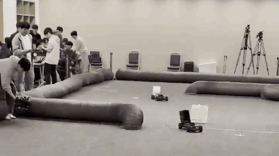
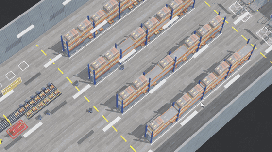

# Subin Park

**Robotics software and AI · Soongsil University**

Hi, I’m an AI Software undergraduate interested in robot perception and autonomous control, especially how robots use sensor data to decide what to do next. I spent eight months as an undergraduate researcher at HUMANE Lab, studying Korean hate speech detection with language models.

[Robotics projects](#robotics-projects) · [Research](#research) · [Contact](#contact)

## Robotics projects

<table>
  <tr>
    <td width="52%" valign="middle">
      
    </td>
    <td width="48%" valign="middle">
      <h3>F1TENTH Adaptive Racing Control</h3>
      
Competition · ROS 2, TinyLidarNet, NVIDIA Jetson

      
I added LiDAR-based speed limits and speed-dependent steering constraints to the race car’s control software.

      
<strong>8th place · Encouragement Award at ICCAS 2025</strong>

      <a href="https://github.com/psubin05/F1TENTH-Adaptive-Racing-Control"><strong>Repository</strong></a>
      &nbsp;·&nbsp;
      <a href="https://github.com/psubin05/F1TENTH-Adaptive-Racing-Control/blob/main/assets/competition-run.mp4"><strong>Full video</strong></a>
    </td>
  </tr>
</table>

<table>
  <tr>
    <td width="52%" valign="middle">
      
    </td>
    <td width="48%" valign="middle">
      <h3>F1TENTH Collision Detection &amp; Reverse Recovery</h3>
      
Course project · Team lead (3 members) · ROS 2

      
I combined distance, impact, and speed signals to detect collisions, then designed when the car should reverse and resume autonomous driving.

      
<strong>Demo shows the car reversing and returning to its route.</strong>

      <a href="https://github.com/psubin05/f1tenth-collision-recovery"><strong>Repository</strong></a>
      &nbsp;·&nbsp;
      <a href="https://github.com/psubin05/f1tenth-collision-recovery/blob/main/%EC%8B%9C%EC%97%B0%20%EC%98%81%EC%83%81.mov"><strong>Full video</strong></a>
    </td>
  </tr>
</table>

<table>
  <tr>
    <td width="52%" valign="middle">
      
    </td>
    <td width="48%" valign="middle">
      <h3>KARCO WES · Warehouse Multi-Robot Simulation</h3>
      
Capstone · In progress · Webots

      
I’m developing a warehouse simulator where transport and patrol robots work from real order data. We use it to study how robots verify and replan tasks when records and shelf contents disagree.

      <a href="https://github.com/graviny/capstone"><strong>Repository</strong></a>
    </td>
  </tr>
</table>

## Research

<table>
  <tr>
    <td width="52%" valign="middle">
      
    </td>
    <td width="48%" valign="middle">
      <h3>LLM-Based Korean Hate Speech Detection</h3>
      
HUMANE Lab · Undergraduate research (8 months)

      
I compared three language models on Korean comments, varying the examples they saw to measure how those examples affected classification.

      
<strong>First-author paper submitted to KSC 2026.</strong>

      <a href="https://github.com/psubin05/hate_self_refine"><strong>Repository</strong></a>
    </td>
  </tr>
</table>

## Additional work

### [Smart Bug Trap](https://github.com/psubin05/Smart-Bug-Trap)

Built a Raspberry Pi prototype that uses YOLOv5 to identify pests from camera footage and an ultrasonic sensor to trigger the trap as they approach.

## Tools

  
  
  
  
  
  

## Contact

  
  

