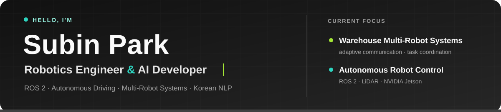
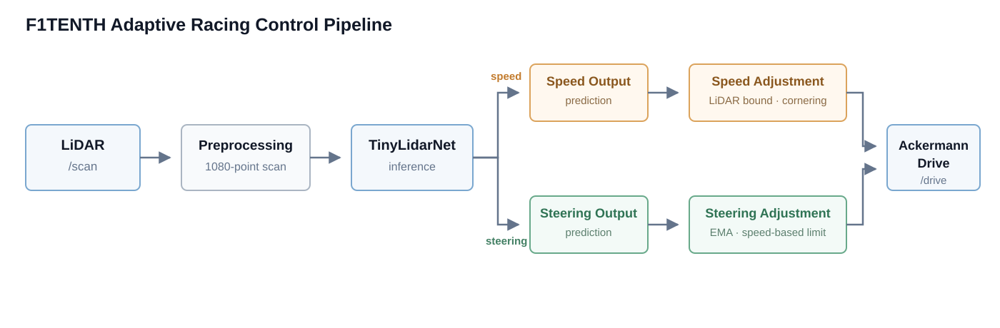
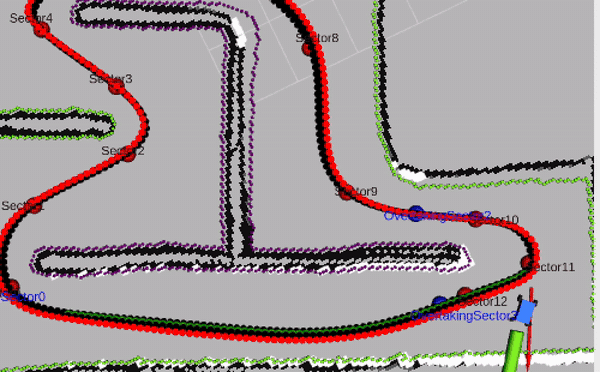
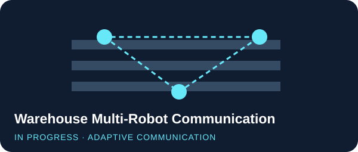
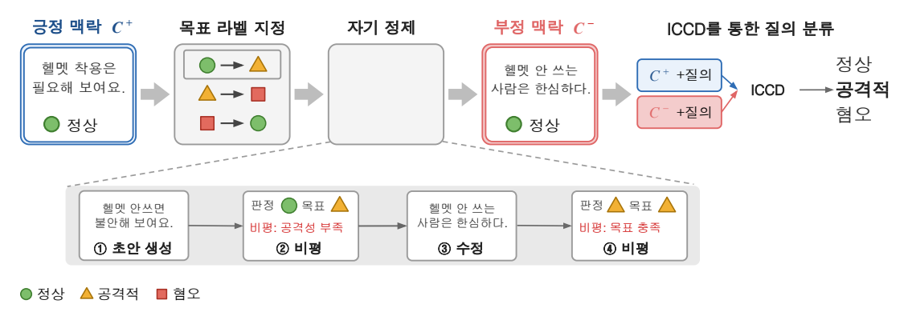

<!--
Profile design system
- Section hierarchy: H2 section > code tag > H3 title > status/achievement > two bullets > links
- Project cards: 52% visual / 48% description, vertically centered
- Link order: Repository first, Video second
- Preserve source-image aspect ratios; do not stretch research figures or demos
-->

  

I work on ROS 2 autonomous driving and warehouse multi-robot systems, with research experience in LLM-based Korean hate speech detection.

## Experience & Focus

<table>
  <tr>
    <td width="50%" valign="top">
      <code>RESEARCH EXPERIENCE</code>
      <h3><a href="https://ssu-humane.github.io/">HUMANE Lab</a></h3>
      <strong>Undergraduate Researcher · 8 months</strong>
      <ul>
        <li>Conducted Korean hate-speech detection research using KOLD.</li>
        <li>Ran ICCD/CD and self-refinement experiments for few-shot classification.</li>
      </ul>
    </td>
    <td width="50%" valign="top">
      <code>CURRENT FOCUS</code>
      <h3>ARCo WES · Warehouse Multi-Robot Simulation</h3>
      <strong>In progress</strong>
      <ul>
        <li>Developing a Webots simulator for warehouse multi-robot operations.</li>
        <li>Studying task verification and dynamic replanning when inventory or task records diverge from the physical state.</li>
      </ul>
    </td>
  </tr>
</table>

## Connect & Core Stack

  <strong>CONNECT</strong>
   
  
  
    
  <strong>CORE STACK</strong>
   
  
  
  
  
  

## Selected Projects

<table>
  <tr>
    <td width="52%" valign="middle">
      
    </td>
    <td width="48%" valign="middle">
      <code>AUTONOMOUS DRIVING · COMPETITION</code>
      <h3>F1TENTH Adaptive Racing Control</h3>
      <strong>🏅 8th Place · Encouragement Award</strong> 
      2025 The 4th F1TENTH Korea Championship · ICCAS 2025
      <ul>
        <li>Runs TinyLidarNet inference in a ROS 2 racing stack on NVIDIA Jetson.</li>
        <li>Adds LiDAR-aware speed limits and speed-dependent steering constraints.</li>
      </ul>
      <a href="https://github.com/psubin05/F1TENTH-Adaptive-Racing-Control"><strong>Repository →</strong></a>
      &nbsp;·&nbsp;
      <a href="https://github.com/psubin05/F1TENTH-Adaptive-Racing-Control/blob/main/assets/competition-run.mp4"><strong>Video →</strong></a>
    </td>
  </tr>
</table>

<table>
  <tr>
    <td width="52%" valign="middle">
      
    </td>
    <td width="48%" valign="middle">
      <code>ROBOT CONTROL · TEAM PROJECT</code>
      <h3>F1TENTH Collision Detection &amp; Reverse Recovery</h3>
      <ul>
        <li>Detects collision states using LiDAR, IMU, and odometry.</li>
        <li>Integrates ROS 2 state transitions for reverse recovery and return to autonomous driving after localization stabilizes.</li>
      </ul>
      <a href="https://github.com/psubin05/f1tenth-collision-recovery"><strong>Repository →</strong></a>
      &nbsp;·&nbsp;
      <a href="https://github.com/psubin05/f1tenth-collision-recovery/blob/main/%EC%8B%9C%EC%97%B0%20%EC%98%81%EC%83%81.mov"><strong>Video →</strong></a>
    </td>
  </tr>
</table>

<table>
  <tr>
    <td width="52%" valign="middle">
      
    </td>
    <td width="48%" valign="middle">
      <code>MULTI-ROBOT · IN PROGRESS</code>
      <h3>ARCo WES · Warehouse Multi-Robot Simulation</h3>
      <ul>
        <li>Simulates a 24 × 14 m warehouse in Webots with patrol and transport robots.</li>
        <li>Uses real order data to model inventory and task-state mismatches for task verification and dynamic replanning.</li>
      </ul>
      <a href="https://github.com/graviny/capstone"><strong>Repository →</strong></a>
    </td>
  </tr>
</table>

<table>
  <tr>
    <td width="52%" valign="middle">
      
    </td>
    <td width="48%" valign="middle">
      <code>HUMANE LAB · UNDERGRADUATE RESEARCH</code>
      <h3>LLM-Based Korean Hate Speech Detection</h3>
      <ul>
        <li>Evaluates KOLD few-shot classification using ICCD/CD experiments.</li>
        <li>Improves macro-F1 from <strong>0.4039</strong> to <strong>0.4636</strong> through self-refinement.</li>
      </ul>
      <a href="https://github.com/psubin05/hate_self_refine"><strong>Repository →</strong></a>
    </td>
  </tr>
</table>
