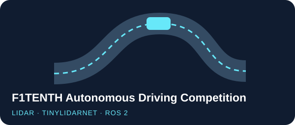

  

  <a href="https://velog.io/@psubin05/posts"><strong>Velog · Dev Blog</strong></a>
  &nbsp;&nbsp;·&nbsp;&nbsp;
  <a href="mailto:psubin0512@gmail.com"><strong>Email</strong></a>

## Selected Projects

<table>
  <tr>
    <td width="50%" valign="top">
      
        
      Adaptive communication for coordinating multiple robots in a warehouse.
        
      <code>In progress</code>
    </td>
    <td width="50%" valign="top">
      
        
      KOLD few-shot classification with ICCD/CD experiments. Reported macro-F1 improved from <strong>0.4039</strong> to <strong>0.4636</strong> with self-refinement.
        
      <a href="https://github.com/psubin05/hate_self_refine"><strong>Experiments &amp; results →</strong></a>
    </td>
  </tr>
  <tr>
    <td width="50%" valign="top">
      
        
      Adapted TinyLidarNet on ROS 2 and Jetson with LiDAR-aware speed limits and speed-dependent steering constraints.
        
      <a href="https://github.com/psubin05/F1TENTH-Adaptive-Racing-Control"><strong>Control implementation →</strong></a>
    </td>
    <td width="50%" valign="top">
      
        
      Implemented collision detection and integrated the ROS 2 state transitions for the team's reverse recovery sequence.
        
      <a href="https://github.com/psubin05/f1tenth-collision-recovery/blob/main/%EC%8B%9C%EC%97%B0%20%EC%98%81%EC%83%81.mov"><strong>Demo →</strong></a>
      &nbsp;·&nbsp;
      <a href="https://github.com/psubin05/f1tenth-collision-recovery"><strong>Code →</strong></a>
    </td>
  </tr>
</table>

  Python · C++ · ROS 2 · LiDAR · NVIDIA Jetson · vLLM

