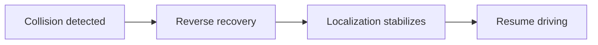

<h1 align="center">Subin Park</h1>

<strong>Korean NLP · Autonomous Driving · Multi-Robot Systems</strong>

<a href="https://velog.io/@psubin05/posts">Velog · Dev Blog</a> &nbsp;·&nbsp; <a href="mailto:psubin0512@gmail.com">Email</a>

## Selected Projects

### 01 · F1TENTH Reverse Recovery

I implemented collision detection and integrated the ROS 2 transitions for the team's reverse recovery sequence.

[Watch the demo](https://github.com/psubin05/f1tenth-collision-recovery/blob/main/%EC%8B%9C%EC%97%B0%20%EC%98%81%EC%83%81.mov) · [View code](https://github.com/psubin05/f1tenth-collision-recovery)

### 02 · Korean Hate Speech Detection

Undergraduate research on KOLD, including ICCD/CD experiments. The reported self-refinement ablation reached **0.4636 macro-F1** vs. **0.4039** for regular in-context learning.

  

[View experiments and results](https://github.com/psubin05/hate_self_refine)

### 03 · F1TENTH Autonomous Driving Competition

Adapted a TinyLidarNet controller on ROS 2 and Jetson, using forward LiDAR clearance to set speed limits and vehicle speed to constrain steering.

[View racing control code](https://github.com/psubin05/F1TENTH-Adaptive-Racing-Control)

### 04 · Warehouse Multi-Robot Communication

**In progress** · Exploring adaptive communication for coordinating multiple robots in a warehouse.
